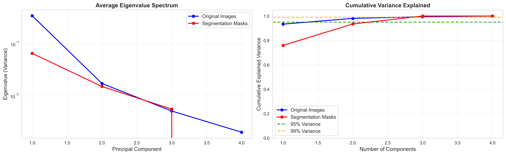

# Brain Tumor MRI Segmentation with PCA / Eigenanalysis

Unsupervised tissue and tumor segmentation of multi-modal brain MRI (BraTS2020). Each pixel is treated as a vector of T1 / T1ce / T2 / FLAIR intensities, PCA via eigendecomposition reduces the dimensionality, and Gaussian mixture or k-means clustering in the reduced space separates the tissue classes.

**Course:** BIOE 485, University of Illinois Urbana-Champaign
**Authors:** Ryan Leuba, Yameng Cai

## Method

Given pixel feature vectors **x**ᵢ ∈ ℝᵖ (one entry per MRI sequence):

1. Stack the samples into X ∈ ℝⁿˣᵖ and center them
2. Compute the covariance C = Xᵀ X / (n − 1)
3. Eigendecompose: C vⱼ = λⱼ vⱼ
4. Project onto the top-k eigenvectors: Y = X Vₖ
5. Cluster in PC space (GMM or k-means) to label the tissue types

Segmentations in PCA space are compared against clustering in the original feature space with the adjusted Rand index (ARI), normalized mutual information (NMI), silhouette, and Davies–Bouldin scores. Where BraTS ground truth is available, they are also compared with Dice / Jaccard.



## Repository layout

```
src/                                  reusable modules
  brats_loader.py                     BraTS2020 NIfTI loading and tumor-slice selection
  data_loader.py                      generic MRI loading / normalization
  pca_analysis.py                     eigenanalysis-based PCA
  segmentation.py                     GMM / k-means segmentation and comparison metrics
  visualization.py                    plotting helpers
  utils.py                            statistics and synthetic-data helpers
  main.py                             SegmentationPipeline class
scripts/
  tissue_segmentation_analysis.py     single-subject walkthrough: PCA, segmentation, comparisons
  pca_comparison_analysis.py          multi-subject PCA vs. original-space comparison
notebooks/                            original notebooks with their rendered outputs
results/                              saved tables and figures
docs/                                 dataset download guides
data/                                 put BraTS2020 here (not tracked)
```

## Running it

```bash
pip install -r requirements.txt

# Works out of the box: falls back to synthetic MRI data if BraTS is not present
python scripts/tissue_segmentation_analysis.py

# Needs the BraTS2020 training data
python scripts/pca_comparison_analysis.py
```

Both scripts resolve paths from the repository root, so you can run them from any directory. Figures go to `results/figures/` and `results/pca_comparison/`. The `# %%` markers keep the original notebook cells for VS Code or Spyder.

## Data

The project uses the **BraTS2020** training set (369 subjects, NIfTI) from Kaggle: [`awsaf49/brats20-dataset-training-validation`](https://www.kaggle.com/datasets/awsaf49/brats20-dataset-training-validation).

```bash
kaggle datasets download -d awsaf49/brats20-dataset-training-validation
unzip brats20-dataset-training-validation.zip -d data/raw/
```

Expected layout:

```
data/raw/BraTS2020_TrainingData/MICCAI_BraTS2020_TrainingData/
├── BraTS20_Training_001/
│   ├── BraTS20_Training_001_t1.nii.gz
│   ├── BraTS20_Training_001_t1ce.nii.gz
│   ├── BraTS20_Training_001_t2.nii.gz
│   ├── BraTS20_Training_001_flair.nii.gz
│   └── BraTS20_Training_001_seg.nii.gz
└── ...
```

Segmentation labels: 0 background, 1 necrotic / non-enhancing core, 2 peritumoral edema, 4 GD-enhancing tumor. See `docs/BRATS_DOWNLOAD_GUIDE.md` and `docs/DATA_SOURCES.md` for details.

## Notes

- The PCA comparison notebook imported `GaussianMixture` and `KMeans` in a cell near the end but used them much earlier, so running it top to bottom raised a `NameError`. The script imports them at the top. This fits `results/pca_comparison/` holding only the eigenvalue and distribution outputs from the earlier cells.
- `statistical_summary.csv` compares PCA reconstruction errors of about 10⁻¹⁶ (floating-point round-off, since every component is kept), so its t-test does not reflect a real difference between methods.

## References

1. Deisenroth, Faisal & Ong, *Mathematics for Machine Learning*.
2. Menze et al., "The Multimodal Brain Tumor Image Segmentation Benchmark (BRATS)," *IEEE Transactions on Medical Imaging*, 2015.
3. Kaggle BraTS2020 dataset: awsaf49/brats20-dataset-training-validation.
